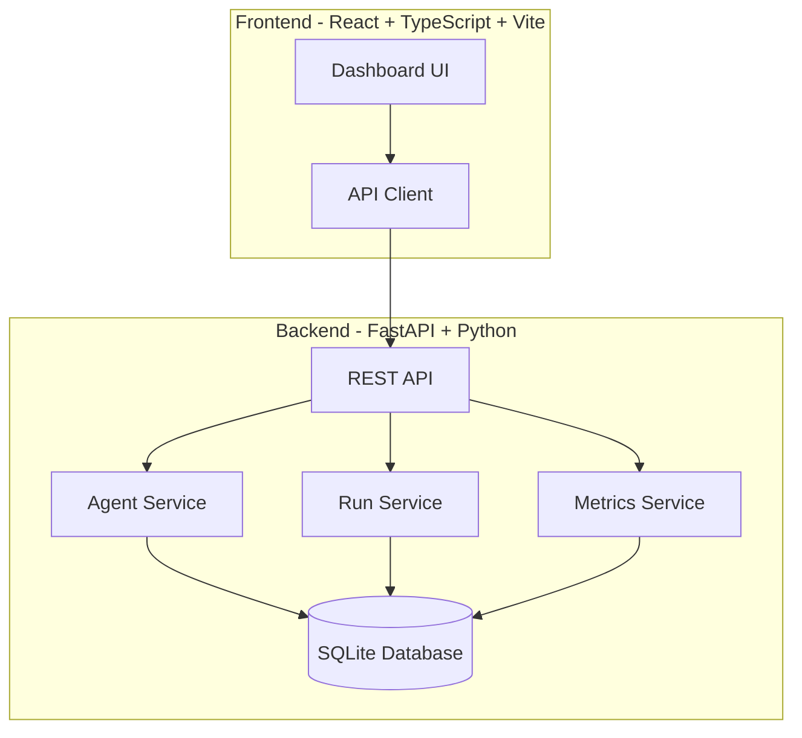

# Prism Observatory

> Work in progress. This checkpoint may be incomplete or fail tests. See PLAN.md and STATUS.md before use.


The open-source app everyone uses to manage agents at work — **Ryan Vo | AI & Machine Learning**

## Overview

Prism Observatory is a developer tool for managing, monitoring, and observing AI agents in production environments. It provides a centralized dashboard to track agent runs, performance metrics, token usage, and execution history — helping teams understand and optimize their agent workflows.

**Problem**: Teams running AI agents at scale lack visibility into agent behavior, performance, and costs.

**Approach**: A FastAPI + React application with persistent storage for agent definitions, run history, and metrics collection. The deterministic core works offline; LLM-powered explanations are opt-in and advisory.

**Intended User**: AI/ML engineers, platform teams, and developers building agent-based systems who need observability into their agent fleets.

## Architecture



## Features

- **Agent Management**: Create, read, update, delete agents with versioning
- **Run Execution**: Trigger and monitor agent runs with real-time logs
- **Observability Dashboard**: Token usage, latency, success rate metrics
- **Export**: Download run data and metrics as CSV/JSON
- **Authentication**: OIDC/Keycloak with SAML broker support (planned)

## Quick Start

### Prerequisites

- Docker and Docker Compose
- Or: Python 3.12+, Node 20+

### Using Docker Compose (Recommended)

```bash
docker compose up --build
```

- Frontend: http://localhost:5173
- Backend API: http://localhost:8000
- API Docs: http://localhost:8000/docs

### Local Development

**Backend:**

```bash
cd backend
python -m venv .venv
source .venv/bin/activate
pip install -r requirements.txt
uvicorn app.main:app --reload --host 0.0.0.0 --port 8000
```

**Frontend:**

```bash
cd frontend
npm install
npm run dev
```

## Testing

### Backend

```bash
cd backend
source .venv/bin/activate
PYTHONPATH=. pytest tests/ -v
```

### Frontend

```bash
cd frontend
npm test
```

### Full Test Suite

```bash
# Backend
cd backend && PYTHONPATH=. pytest tests/ -v

# Frontend
cd frontend && npm test
```

## API Reference

### Health Check

```
GET /api/healthz
```

Response:
```json
{
  "status": "ok",
  "service": "prism-observatory"
}
```

### Root

```
GET /
```

Response:
```json
{
  "name": "Prism Observatory",
  "version": "0.1.0",
  "status": "running"
}
```

## Configuration

### Environment Variables

| Variable | Description | Default |
|----------|-------------|---------|
| `PYTHONPATH` | Python module path | `/app` |

## Security Limitations

- Current version uses SQLite for simplicity; production should use PostgreSQL
- No authentication implemented yet (planned: OIDC/Keycloak)
- CORS configured for development; restrict in production
- No rate limiting on API endpoints

## AI/ML Evaluation

Prism Observatory is designed to collect evaluation data for AI agents. The observability dashboard will support:

- **Reproducible command**: `docker compose up` then trigger agent runs via API
- **Data provenance**: Agent runs stored with full context (inputs, outputs, tool calls)
- **Baseline metrics**: Token usage, latency, success rate per agent version
- **Failure cases**: Error tracking, timeout detection, retry analysis

*Evaluation features are under active development.*

## Project Structure

```
prism-observatory/
├── backend/
│   ├── app/
│   │   ├── api/          # API routes
│   │   ├── core/         # Core config, security
│   │   ├── models/       # Pydantic models
│   │   ├── services/     # Business logic
│   │   └── main.py       # FastAPI entrypoint
│   ├── tests/            # Pytest tests
│   ├── requirements.txt
│   └── Dockerfile
├── frontend/
│   ├── src/
│   │   ├── components/   # React components
│   │   ├── api/          # Typed API client
│   │   ├── App.tsx
│   │   └── main.tsx
│   ├── tests/            # Vitest tests
│   ├── package.json
│   ├── vite.config.ts
│   ├── Dockerfile
│   └── nginx.conf
├── docker-compose.yaml
├── feature-plan.json
├── PLAN.md
├── CHANGELOG.md
├── LICENSE
├── portfolio.json
└── README.md
```

## License

MIT License — see [LICENSE](LICENSE) for details.

---

**Ryan Vo** — ryandtvo@gmail.com